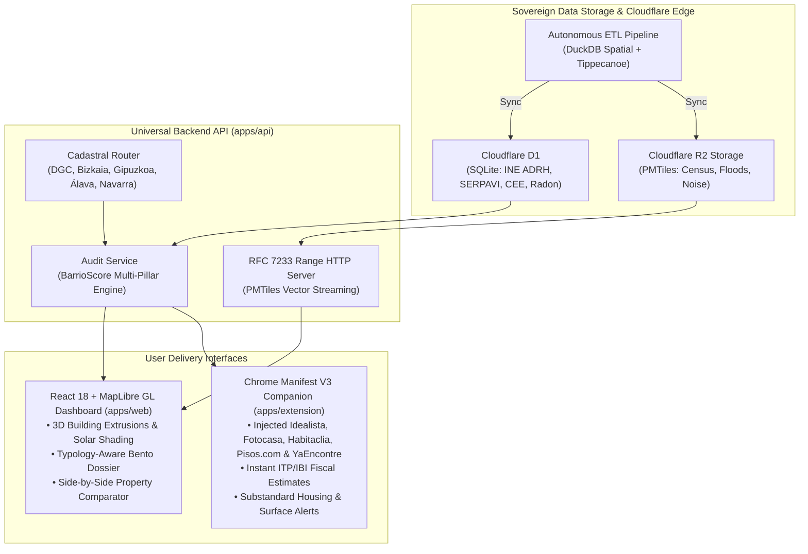

# OpenBarrio 🏘️🇪🇸

[](https://github.com/alexcg1/openbarrio/actions/workflows/ci.yml)
[](CHANGELOG.md)
[](LICENSE)
[](https://nodejs.org/)
[](https://pnpm.io/)
[](docker-compose.yml)

**OpenBarrio** is a sovereign open-source civic-tech and real estate due diligence platform that aggregates, normalizes, and visualizes official open data from Spanish public administrations:
* **Sede Electrónica del Catastro (DGC & Foral):** Construction year, surface area, horizontal division unit picking, and INSPIRE WFS 3D building volumetric geometry.
* **INE (Instituto Nacional de Estadística):** Atlas de Distribución de Renta de los Hogares (ADRH, ~37,000 census sections), demographics, and Tourist Dwellings (VUT).
* **CTE DB-HS 6:** Official municipal radon geological hazard classifications and mandatory mitigation prescriptions.
* **MITECO:** SICA strategic acoustic noise contours (>40,000 national isochrones), SNCZI flood hazard cartography (>28,000 fluvial polygons), and real-time Air Quality.
* **MIVAU:** SERPAVI statutory rental benchmark index under Ley 12/2023 por el Derecho a la Vivienda.

---

## 🏛️ System Architecture



---

## ✨ Key Platform Features

### 1. Building Structural Health (ITE/IEE), 15-Minute City WalkScore & Seismic Hazard (v1.3.0)
* **Building Technical Inspection (ITE/IEE) Integration:** Municipal open data ingestion (Madrid, Barcelona, Euskadi, Valencia) cross-referenced with official Sede del Catastro construction years. Evaluates favorable/unfavorable outcomes, active structural defects, and statutory preventive alerts for buildings $\ge 50$ years in un-digitalized municipalities under RD-L 7/2015 art. 29.
* **15-Minute City Pedestrian Isochrones:** Client-side parametric isochrones in MapLibre GL generating 5-minute (375m), 10-minute (750m), and 15-minute (1125m) walking catchment zones with 1.25x urban tortuosity and multi-category civic amenities density analysis.
* **IGN NCSE-02 Seismic Hazard & Vulnerability:** Municipal basic seismic acceleration ($a_b$) mapping across all ~8,131 Spanish municipalities. Identifies pre-1994 unreinforced structural vulnerabilities in moderate-to-high risk zones ($a_b \ge 0.08g$).
* **Companion Extension & Dossier Parity:** Injected ITE status badges in real estate portals and dedicated interactive cards (`BuildingInspectionCard`, `PedestrianIsochronesCard`, `SeismicSafetyCard`) in the due diligence dossier with full 5-language translation.

### 2. Multi-Portal Expansion, Antifraud Infravivienda & Property Duel 2.0 (v1.2.0)
* **Expanded Portal Companion Widget:** Abstract `BasePortalAdapter` with unified Shadow DOM lifecycle across 5 top real estate portals: **Idealista**, **Fotocasa**, **Habitaclia**, **Pisos.com**, and **YaEncontre**.
* **Substandard Housing & Commercial Conversion Antifraud:** Algorithmic heuristic detecting non-residential Cadastral uses (`COMERCIAL`, `ALMACÉN`, `OFICINAS`) on ground floors or basements without cédula de habitabilidad or horizontal division. Penalizes BarrioScore by up to 25 points and alerts users to municipal fines up to €600,000.
* **Property Duel 2.0 — Multi-Property Matrix:** Multi-asset comparative matrix comparing up to 4 properties simultaneously (A: Cyan, B: Amber, C: Purple, D: Emerald) with 4-polygon SVG radar overlays, differential telemetry deltas, and shareable URL state persistence via `?compare=ref1,ref2,ref3,ref4`.
* **Playwright Synthetic Monitoring:** Automated weekly CI/CD workflow testing frozen canonical DOM snapshots of all 5 portals to catch selector breakage and anti-bot anomalies before they impact end-users.

### 3. Sovereign PMTiles Vector Streaming
All national administrative, demographic, and environmental layers are compiled into sovereign **PMTiles v3** vector archives hosted on Cloudflare R2:
* **`census_tracts.pmtiles` (85.3 MB):** All ~37,000 Spanish census sections with embedded household net revenue and municipal percentile ranks.
* **`floods.pmtiles` (556.5 MB):** All 28,021 official MITECO SNCZI flood hazard polygons across T=10, 50, 100, 500 return periods and Preferential Flow Zones (ZFP).
* **`noise.pmtiles` (150.4 MB):** All 40,011 strategic acoustic noise isochrones from MITECO SICA (airports, high-speed rail, highways, metropolitan agglomerations).

Served via HTTP Range requests with sub-15ms tile latency and zero external ministerial dependency.

### 4. Civic Micro-Tools & Programmatic SEO (v1.1.0)
* **High-Intent Standalone & Embeddable Micro-Tools:**
  * `/comprobar-metros-catastro`: Instant surface discrepancy check between listing m² and official Catastro OVC records with >15% legal alert threshold and overpayment estimate.
  * `/calculadora-alquiler-legal`: Statutory rent cap calculator under Ley 12/2023 por el Derecho a la Vivienda, evaluating Zonas Tensionadas, Gran Tenedor rules, and SERPAVI benchmarks.
  * `/simulador-itp-ibi`: Comprehensive regional ITP tax estimator across all 17 Autonomous Communities, reduced youth/family brackets, notary and registry fees (RD 1426/1989 and RD 1427/1989), and annual municipal IBI.
  * `?embed=true` mode: Minimalist responsive widget mode for easy iframe embedding in civic media and real estate platforms.
* **Programmatic Municipal & District SEO Engine:**
  * Dynamic municipal exploration pages (`/municipio/:slug`) for ~8,000 Spanish territories with aggregated INE ADRH household revenue, SERPAVI rental status, CTE DB-HS 6 radon hazard zones, and municipal BarrioScore.
  * National directory (`/municipios`) with real-time filtering and province search.
  * Structured JSON-LD Schema.org metadata (`AdministrativeArea`, `BreadcrumbList`, `Dataset`, `SoftwareApplication`, `FinancialProduct`) and automated canonical XML sitemaps.
* **Dynamic Edge OpenGraph Social Cards:**
  * High-contrast Obsidian `#0B1326` SVG social cards generated dynamically at the edge (`/api/v1/og/municipio/:slug` and `/api/v1/og/tool/:tool`) with live metric badges and administration seals.
* **Web-to-Extension Conversion CTA:**
  * Contextual in-content banners and non-intrusive floating sticky notification bar with automatic Chromium detection.

### 5. MapLibre Thematic Lenses & Progressive Executive Disclosure (v1.0.0)
* **Thematic Lenses Selector:** 4 specialized cartographic views centered atop the map (`Vida Urbana`, `Silencio`, `Riesgos Naturales`, `Luz 3D`) with adaptive auto-activation based on property typology (e.g. rustic parcels automatically activate flood risk cartography).
* **3-Second Executive Summary:** Instant executive dossier signal with overall score, critical alert banners (surface discrepancy >15%, active flood zones, expired energy certificates under RD 390/2021), and 3 instant verdict pills before progressive disclosure of in-depth technical analysis.
* **Unified Sovereign Search:** Single unified search input with auto-detection of cadastral references and addresses, eliminating manual mode toggling.
* **Store-Ready Extension Bundle:** Zero-dependency packaging pipeline (`pnpm package:extension`) generating audited, verified `openbarrio-extension-v1.3.0.zip` ready for Chrome Web Store.
* **Dedicated Data Transparency Portal:** Independent `/fuentes-oficiales` route detailing compliance with Directive INSPIRE 2007/2/EC and Law 19/2013.

### 6. Urban 3D Extrusion & Solar Simulation
* **INSPIRE 3D Volumetric Extrusions:** Live rendering of cadastral parcels with true building heights and adjoining surrounding building context.
* **Dynamic Solar Shading HUD:** Real-time astronomical solar position calculation throughout the year with cast shadows onto facades to assess winter light exposure and thermal comfort.

### 7. Non-Residential Typology Adaptation
Diligent reports automatically adapt according to official Catastro usage typology (`PropertyTypology`):
* **`VACANT_PLOT` (*Solar Urbano*):** Evaluates development potential without penalizing lack of building antiquity, ITE, or residential energy certificates.
* **`INDUSTRIAL` (*Nave Industrial*):** Assesses logistics connectivity, RSCIEI fire standards, and environmental corridors without residential rent caps.
* **`RUSTIC` (*Finca Rústica*):** Emphasizes environmental preservation and hydrological safety while suppressing residential CapEx.
* **`COMMERCIAL` / `EQUIPMENT` / `RESIDENTIAL`:** Tailored metric benchmarks for every real estate asset class.

### 8. High-Performance Autonomous ETL Pipeline
* **GitHub Actions 4-Job Concurrency Matrix:** Independent parallel execution across `etl-ine-ign`, `etl-snczi-floods`, `etl-sica-noise`, and `etl-civic-cee`.
* **Adaptive Connection Pooling:** 6 concurrent worker threads with exponential backoff and randomized jitter (`0.5s - 2.5s`) for ministerial GeoServers.
* **Zero-Transfer No-Op Caching:** Inspects upstream `ETag`/`Last-Modified` against `data/etl_manifest.json` and skips redundant downloads when datasets are current.

---

## 🚀 Quick Start with Docker (Zero Host Pollution)

OpenBarrio adheres to a strict **Zero Host Pollution** policy: Node.js, pnpm, Python, or native databases do not need to be installed on your host machine. Everything runs containerized via **Docker Desktop**:

### 1. Launch the Stack
```bash
make docker-up
# or:
docker compose up -d
```

### 2. Available Local Endpoints
* **Web Dashboard:** [http://localhost:5173](http://localhost:5173) (React + MapLibre GL + Stitch Glassmorphic HUD)
* **REST API:** [http://localhost:3001](http://localhost:3001) (Hono Universal API)
* **OpenAPI / Swagger:** [http://localhost:3001/docs](http://localhost:3001/docs)

### 3. Running Containerized Tests & Linting
```bash
# Execute Vitest across all workspace projects (538/538 passing):
make docker-test

# Run ESLint with zero warnings:
make docker-lint
```

---

## 📦 Monorepo Workspace Structure

```
openbarrio/
├── packages/
│   ├── core/           # Shared TypeScript schemas, TypeBox DTOs, scoring & typology models
│   └── etl/            # Autonomous DuckDB Spatial pipelines for INE, IGN, SNCZI & SICA
├── apps/
│   ├── api/            # Hono Universal API (Cloudflare Workers & Node.js) with OpenAPI docs
│   ├── web/            # React 18 + Vite web exploration dashboard and due diligence dossier
│   └── extension/      # Chrome Manifest V3 companion widget (Idealista & Fotocasa)
├── data/               # Seed datasets, SQLite persistence and etl_manifest.json
├── scripts/            # Database initialization and quality gatekeeper scripts
├── .github/workflows/  # Automated CI/CD, SAST CodeQL, and 4-job ETL pipelines
├── docker-compose.yml  # Containerized development stack
└── pnpm-workspace.yaml # Monorepo workspace configuration
```

---

## 🛡️ Security & Governance
* See [SECURITY.md](file:///SECURITY.md) for vulnerability disclosure protocols, CodeQL SAST configuration, and supply chain governance.
* See [AGENTS.md](file:///AGENTS.md) for universal agent and contributor guidelines.
* See [CHANGELOG.md](file:///CHANGELOG.md) for release version history.

---

## ⚖️ License
Licensed under the [Apache License, Version 2.0](file:///LICENSE).
