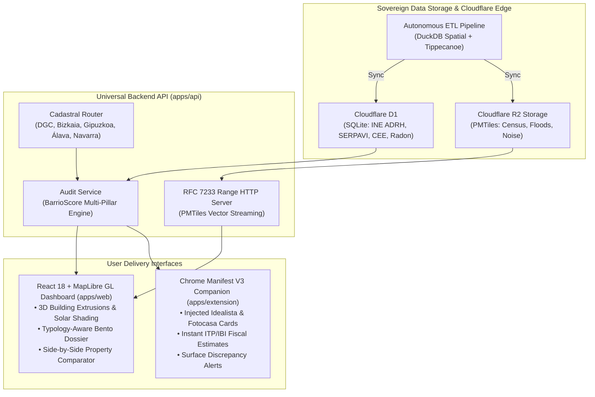

# OpenBarrio 🏘️🇪🇸

[](https://github.com/alexcg1/openbarrio/actions/workflows/ci.yml)
[](CHANGELOG.md)
[](LICENSE)
[](https://nodejs.org/)
[](https://pnpm.io/)
[](docker-compose.yml)

**OpenBarrio** is a sovereign open-source civic-tech and real estate due diligence platform that aggregates, normalizes, and visualizes official open data from Spanish public administrations:
* **Sede Electrónica del Catastro (DGC & Foral):** Construction year, surface area, horizontal division unit picking, and INSPIRE WFS 3D building volumetric geometry.
* **INE (Instituto Nacional de Estadística):** Atlas de Distribución de Renta de los Hogares (ADRH, ~37,000 census sections), demographics, and Tourist Dwellings (VUT).
* **CTE DB-HS 6:** Official municipal radon geological hazard classifications and mandatory mitigation prescriptions.
* **MITECO:** SICA strategic acoustic noise contours (>40,000 national isochrones), SNCZI flood hazard cartography (>28,000 fluvial polygons), and real-time Air Quality.
* **MIVAU:** SERPAVI statutory rental benchmark index under Ley 12/2023 por el Derecho a la Vivienda.

---

## 🏛️ System Architecture



---

## ✨ Key Platform Features

### 1. Sovereign PMTiles Vector Streaming
All national administrative, demographic, and environmental layers are compiled into sovereign **PMTiles v3** vector archives hosted on Cloudflare R2:
* **`census_tracts.pmtiles` (85.3 MB):** All ~37,000 Spanish census sections with embedded household net revenue and municipal percentile ranks.
* **`floods.pmtiles` (556.5 MB):** All 28,021 official MITECO SNCZI flood hazard polygons across T=10, 50, 100, 500 return periods and Preferential Flow Zones (ZFP).
* **`noise.pmtiles` (150.4 MB):** All 40,011 strategic acoustic noise isochrones from MITECO SICA (airports, high-speed rail, highways, metropolitan agglomerations).

Served via HTTP Range requests with sub-15ms tile latency and zero external ministerial dependency.

### 2. Urban 3D Extrusion & Solar Simulation
* **INSPIRE 3D Volumetric Extrusions:** Live rendering of cadastral parcels with true building heights and adjoining surrounding building context.
* **Dynamic Solar Shading HUD:** Real-time astronomical solar position calculation throughout the year with cast shadows onto facades to assess winter light exposure and thermal comfort.

### 3. Non-Residential Typology Adaptation
Diligence reports automatically adapt according to official Catastro usage typology (`PropertyTypology`):
* **`VACANT_PLOT` (*Solar Urbano*):** Evaluates development potential without penalizing lack of building antiquity, ITE, or residential energy certificates.
* **`INDUSTRIAL` (*Nave Industrial*):** Assesses logistics connectivity, RSCIEI fire standards, and environmental corridors without residential rent caps.
* **`RUSTIC` (*Finca Rústica*):** Emphasizes environmental preservation and hydrological safety while suppressing residential CapEx.
* **`COMMERCIAL` / `EQUIPMENT` / `RESIDENTIAL`:** Tailored metric benchmarks for every real estate asset class.

### 4. High-Performance Autonomous ETL Pipeline
* **GitHub Actions 4-Job Concurrency Matrix:** Independent parallel execution across `etl-ine-ign`, `etl-snczi-floods`, `etl-sica-noise`, and `etl-civic-cee`.
* **Adaptive Connection Pooling:** 6 concurrent worker threads with exponential backoff and randomized jitter (`0.5s - 2.5s`) for ministerial GeoServers.
* **Zero-Transfer No-Op Caching:** Inspects upstream `ETag`/`Last-Modified` against `data/etl_manifest.json` and skips redundant downloads when datasets are current.

---

## 🚀 Quick Start with Docker (Zero Host Pollution)

OpenBarrio adheres to a strict **Zero Host Pollution** policy: Node.js, pnpm, Python, or native databases do not need to be installed on your host machine. Everything runs containerized via **Docker Desktop**:

### 1. Launch the Stack
```bash
make docker-up
# or:
docker compose up -d
```

### 2. Available Local Endpoints
* **Web Dashboard:** [http://localhost:5173](http://localhost:5173) (React + MapLibre GL + Stitch Glassmorphic HUD)
* **REST API:** [http://localhost:3001](http://localhost:3001) (Hono Universal API)
* **OpenAPI / Swagger:** [http://localhost:3001/docs](http://localhost:3001/docs)

### 3. Running Containerized Tests & Linting
```bash
# Execute Vitest across all 5 workspace projects (372/372 passing):
make docker-test

# Run ESLint with zero warnings:
make docker-lint
```

---

## 📦 Monorepo Workspace Structure

```
openbarrio/
├── packages/
│   ├── core/           # Shared TypeScript schemas, TypeBox DTOs, scoring & typology models
│   └── etl/            # Autonomous DuckDB Spatial pipelines for INE, IGN, SNCZI & SICA
├── apps/
│   ├── api/            # Hono Universal API (Cloudflare Workers & Node.js) with OpenAPI docs
│   ├── web/            # React 18 + Vite web exploration dashboard and due diligence dossier
│   └── extension/      # Chrome Manifest V3 companion widget (Idealista & Fotocasa)
├── data/               # Seed datasets, SQLite persistence and etl_manifest.json
├── scripts/            # Database initialization and quality gatekeeper scripts
├── .github/workflows/  # Automated CI/CD, SAST CodeQL, and 4-job ETL pipelines
├── docker-compose.yml  # Containerized development stack
└── pnpm-workspace.yaml # Monorepo workspace configuration
```

---

## 🛡️ Security & Governance
* See [SECURITY.md](file:///SECURITY.md) for vulnerability disclosure protocols, CodeQL SAST configuration, and supply chain governance.
* See [AGENTS.md](file:///AGENTS.md) for universal agent and contributor guidelines.
* See [CHANGELOG.md](file:///CHANGELOG.md) for release version history.

---

## ⚖️ License
Licensed under the [Apache License, Version 2.0](file:///LICENSE).
